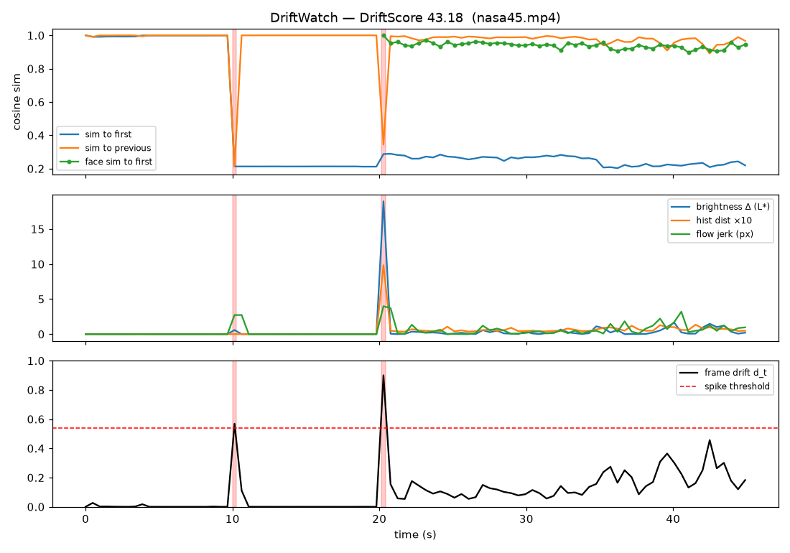

> **DISCONTINUED (2026-11-06)** — PureFxAi is no longer developing DriftWatch Video. This repository is archived. Do not use the old Pages site as an active product page.

# 🎬 DriftWatch Video

**Why do AI-generated videos drift, flicker and lose identity over time — and how do we fix it?**
**ทำไมวิดีโอที่สร้างด้วย AI ถึงเพี้ยน กระพริบ และเสียความต่อเนื่องของตัวละคร และจะแก้อย่างไร?**

An open research project by PureFxAi studying **temporal consistency** in AI video: an open benchmark and metrics for *drift* (faces, objects, colours and physics changing across frames) in open-weight video generation models, plus tests of lightweight methods to reduce it.

โครงการวิจัยเปิดโดย PureFxAi ศึกษา **ความต่อเนื่องตามเวลา** ของวิดีโอ AI: สร้างชุดทดสอบและตัวชี้วัดแบบเปิดสำหรับการ "เพี้ยน" (ใบหน้า วัตถุ สี ฟิสิกส์ที่เปลี่ยนระหว่างเฟรม) ในโมเดลสร้างวิดีโอแบบ open-weight แล้วทดลองวิธีลดปัญหานี้

> **Status: early stage.** v0.1 measurement tool available (below); no benchmark results yet. Everything published will include code, prompts, seeds and raw videos to reproduce it.
> **สถานะ: ระยะเริ่มต้น** มีเครื่องมือวัด v0.1 แล้ว ยังไม่มีผล benchmark ทุกผลที่เผยแพร่จะมีโค้ด prompt seed และวิดีโอดิบให้ทำซ้ำได้

## ❓ Research questions / คำถามวิจัย
1. Can drift be measured automatically in a way that agrees with human judgement? / วัดการเพี้ยนอัตโนมัติให้ตรงกับการตัดสินของคนได้หรือไม่
2. How does drift grow with clip length, motion and number of subjects? / การเพี้ยนเพิ่มขึ้นอย่างไรตามความยาว การเคลื่อนไหว และจำนวนตัวละคร
3. Which training-free methods (reference frames, feature caching, guidance tweaks) reduce drift, at what compute cost? / วิธีที่ไม่ต้องเทรนใหม่แบบไหนลดการเพี้ยนได้ และใช้ทรัพยากรเท่าไร
4. Can video-understanding models flag drifted segments for regeneration? / โมเดลเข้าใจวิดีโอตรวจจับช่วงที่เพี้ยนเพื่อสร้างใหม่ได้หรือไม่

## 🗺️ Roadmap
- [ ] **Phase 1** — Open prompt suite (people, animals, objects, camera motion) + human rating protocol
- [ ] **Phase 2** — Drift metrics (identity-embedding similarity, colour/optical-flow stability) validated against human ratings
- [ ] **Phase 3** — Benchmark open-weight video models; publish raw outputs
- [ ] **Phase 4** — Test & report mitigation methods, including negative results

## 🛠️ Tool v0.1: `driftwatch` / เครื่องมือวัดการเพี้ยน v0.1

A CPU-friendly Python CLI that samples frames from a video and measures how much it drifts over time.
เครื่องมือ Python (รันบน CPU ได้) ที่สุ่มเฟรมจากวิดีโอแล้ววัดว่าภาพเพี้ยนไปตามเวลามากแค่ไหน

### Install / ติดตั้ง
```bash
git clone https://github.com/purefxaidev/driftwatch-video && cd driftwatch-video
pip install -e ".[clip,dev]"      # core only: pip install -e .
# CPU-only torch (smaller): pip install torch --index-url https://download.pytorch.org/whl/cpu
```

### Usage / วิธีใช้
```bash
driftwatch analyze video.mp4 --out report/ --fps 2
# options: --max-frames 300  --backend auto|clip|pixel  --no-faces  --no-flow
pytest -q                          # synthetic stable vs. abrupt videos
```
Outputs in `report/`: `drift.json` (per-frame scores + aggregate), `drift_chart.png` (spikes shaded red), `report.html`.
ผลลัพธ์: `drift.json` (คะแนนรายเฟรม + คะแนนรวม), `drift_chart.png` (ช่วงเพี้ยนแรเงาสีแดง), `report.html`

### Metrics / ตัวชี้วัด
| Metric | How |
|---|---|
| Semantic drift | open_clip ViT-B-32 image embeddings; cosine similarity to first & previous frame (falls back to a weak pixel embedding if torch is missing) |
| Colour / brightness flicker | change of mean LAB L* and a/b, Bhattacharyya distance of HSV histograms vs previous frame |
| Face identity drift (optional) | OpenCV YuNet face detector (~230 KB, auto-downloaded once); largest face crop embedded with CLIP, similarity to first face. A *proxy*, not a face-recognition model. Skipped if no face/detector |
| Motion smoothness (optional) | Farneback optical flow; "jerk" = change in mean flow magnitude between steps |

**DriftScore (0–100, heuristic):** per-frame `d_t` = weighted mean of clipped components (0.4 semantic `(1−sim_prev)/0.15`, 0.2 hist `/0.5`, 0.2 brightness `/10 L*`, 0.1 flow jerk `/2 px`, 0.1 face `(1−sim)/0.25`).
`DriftScore = 100 × (0.4·mean(d_t) + 0.3·p95(d_t) + 0.3·clip((1 − mean sim_first)/0.3))`. Spikes: `d_t > max(0.25, median + 4·1.4826·MAD)`.
⚠️ Weights and scales are hand-picked and **not yet validated against human ratings** (that is Phase 2). Use for relative comparison only.
น้ำหนักและสเกลตั้งด้วยมือ **ยังไม่ได้ตรวจสอบเทียบกับการให้คะแนนของคน** ใช้เปรียบเทียบเชิงสัมพัทธ์เท่านั้น

### Example output / ตัวอย่างผล (CPU, 2 fps)
| Video | Frames | DriftScore | Spikes |
|---|---|---|---|
| Synthetic stable (`driftwatch.synth`) | 12 | 7.62 | 0 |
| Synthetic abrupt changes | 12 | 69.46 | 3 |
| [NASA SVS14704 interview](https://commons.wikimedia.org/wiki/File:NASA_Interview_Opportunity-_Star_light,_star_bright,_check_out_the_evening_sky_on_your_Halloween_walk_tonight_(SVS14704_-_RebekahCannedInterview).webm), first 45 s, public domain | 94 | 43.18 | 2 (10.1 s, 20.3 s — real scene cuts) |



The real clip is a normal edited video, not AI-generated: the two spikes are intentional cuts between title cards and the interview, which shows a limitation — v0.1 cannot tell an edit from a generation glitch. Face similarity stayed ~0.90–0.97 for the speaker.
คลิปจริงนี้ไม่ใช่วิดีโอ AI จุดพีค 2 จุดคือการตัดต่อเปลี่ยนฉาก แสดงข้อจำกัดว่า v0.1 ยังแยกการตัดต่อกับความผิดพลาดของ AI ไม่ได้

### Limitations / ข้อจำกัด
- Heuristic score, no human-rating validation yet; scales tuned on few clips. / คะแนนเป็นแบบ heuristic
- Scene cuts, fast camera motion and intentional lighting changes count as drift. / การตัดต่อ กล้องเคลื่อนเร็ว แสงที่ตั้งใจเปลี่ยน ถูกนับเป็นการเพี้ยน
- "Long-term drift" vs first frame penalises legitimately evolving scenes. / ฉากที่เปลี่ยนตามเนื้อเรื่องจะโดนหักคะแนน
- Face identity uses CLIP on face crops, not ArcFace-style recognition; only the largest face is tracked. / ใช้ CLIP กับภาพใบหน้า ไม่ใช่โมเดลจดจำใบหน้าโดยตรง
- First run downloads the CLIP weights (~600 MB) and YuNet model; CPU speed ≈ 1–3 frames/s.

## 🤝 Contributing / ร่วมพัฒนา
Help with prompts, human ratings, metrics or GPU time is welcome. See [CONTRIBUTING.md](CONTRIBUTING.md) and [research/TEMPLATE.md](research/TEMPLATE.md).

## 💚 Donate USDT / สนับสนุนด้วย USDT
Donations fund compute (GPU hours) and dataset review. / เงินบริจาคใช้ค่าประมวลผลและการตรวจสอบชุดข้อมูล

**Network: Ethereum (ERC20) only / เครือข่าย Ethereum (ERC20) เท่านั้น**

```
0x920deab53daf94ca2030ad5ceec2265bf5686941
```


Donation page: https://purefxaidev.github.io/driftwatch-video/

⚠️ Send **only USDT via ERC20**. Other networks or tokens may be lost permanently.
ส่งเฉพาะ **USDT ผ่าน ERC20** เท่านั้น เครือข่ายหรือเหรียญอื่นอาจสูญหายถาวร

Donations are voluntary support — **not an investment**, with no returns or rewards.
การบริจาคเป็นการสนับสนุนโดยสมัครใจ **ไม่ใช่การลงทุน** และไม่มีผลตอบแทนใด ๆ

## License
Code: MIT. Prompt suite & ratings (when released): CC-BY-4.0.
