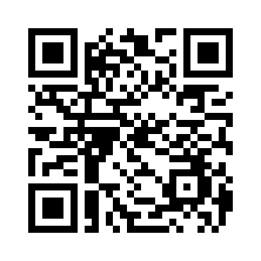

# ⚖️ Khwamjing Bench (ความจริง)

**Does an AI know when it doesn't know — in Thai?**
**AI รู้ไหมว่าตัวเองไม่รู้ เมื่อตอบเป็นภาษาไทย?**

An open research project by PureFxAi measuring **hallucination and confidence calibration** of large language models when answering in Thai, compared with the same questions in English.

โครงการวิจัยเปิดโดย PureFxAi เพื่อวัด **การแต่งข้อมูล (hallucination) และความแม่นยำของความมั่นใจ (calibration)** ของโมเดลภาษาเมื่อตอบเป็นภาษาไทย เทียบกับคำถามเดียวกันในภาษาอังกฤษ

> **Status: early stage.** No benchmark results exist yet. Everything published here will include code and data to reproduce it.
> **สถานะ: ระยะเริ่มต้น** ยังไม่มีผลลัพธ์ใด ๆ ทุกผลที่เผยแพร่จะมีโค้ดและข้อมูลให้ทำซ้ำได้

## ❓ Research questions / คำถามวิจัย
1. Do LLMs hallucinate more often in Thai than in English on identical factual questions? / โมเดลแต่งข้อมูลในภาษาไทยมากกว่าภาษาอังกฤษหรือไม่
2. Is stated confidence ("I'm sure…") calibrated against actual accuracy in Thai? / ความมั่นใจที่โมเดลบอกตรงกับความถูกต้องจริงหรือไม่
3. How often do models correctly say "ไม่ทราบ / I don't know" on unanswerable questions? / โมเดลยอมรับว่าไม่รู้บ่อยแค่ไหน
4. Which cheap methods (prompting, self-consistency, retrieval) reduce Thai hallucination most? / วิธีง่าย ๆ แบบไหนลดการแต่งข้อมูลได้มากที่สุด

## 🗺️ Roadmap
- [ ] **Phase 1** — Parallel Thai/English question set (answerable + deliberately unanswerable), community-reviewed, CC-BY licensed
- [ ] **Phase 2** — Evaluation harness (open-weight models first), metrics: accuracy, abstention rate, Expected Calibration Error
- [ ] **Phase 3** — First public report with full raw outputs
- [ ] **Phase 4** — Test mitigation methods and publish what works and what doesn't

## 🤝 Contributing / ร่วมพัฒนา
Native Thai speakers who can write or verify questions are especially welcome. See [CONTRIBUTING.md](CONTRIBUTING.md) and [research/TEMPLATE.md](research/TEMPLATE.md).

## 💚 Donate USDT / สนับสนุนด้วย USDT
Donations fund compute (GPU hours) and dataset review. / เงินบริจาคใช้ค่าประมวลผลและการตรวจสอบชุดข้อมูล

**Network: Ethereum (ERC20) only / เครือข่าย Ethereum (ERC20) เท่านั้น**

```
0x920deab53daf94ca2030ad5ceec2265bf5686941
```



Donation page: https://purefxaidev.github.io/khwamjing-bench/

⚠️ Send **only USDT via ERC20**. Other networks or tokens may be lost permanently.
ส่งเฉพาะ **USDT ผ่าน ERC20** เท่านั้น เครือข่ายหรือเหรียญอื่นอาจสูญหายถาวร

Donations are voluntary support — **not an investment**, with no returns or rewards.
การบริจาคเป็นการสนับสนุนโดยสมัครใจ **ไม่ใช่การลงทุน** และไม่มีผลตอบแทนใด ๆ

## License
Code: MIT. Dataset (when released): CC-BY-4.0.
